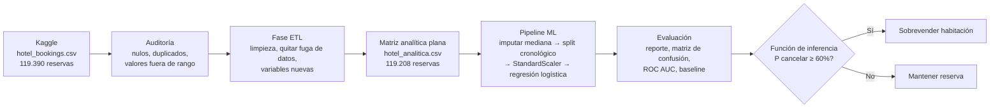

# Predicción de cancelaciones de reservas de hotel — Regresión logística

**Objetivo:** predecir si una reserva de hotel se va a **cancelar** (sí/no) y, con esa probabilidad,
decidir si el hotel puede **sobrevender** la habitación (umbral de decisión del 60%).

**Dataset:** [Hotel Booking Demand — Kaggle](https://www.kaggle.com/datasets/jessemostipak/hotel-booking-demand)
(119.390 reservas reales de un hotel urbano y un resort en Portugal, julio 2015 – agosto 2017, 32 columnas).

## Diagrama de flujo

## Variables del modelo

| Tipo | Variable | Descripción | Columna original |
|---|---|---|---|
| Independiente | `dias_anticipacion` | Días entre la reserva y la llegada | `lead_time` |
| Independiente | `noches_totales` | Noches de fin de semana + entre semana | `stays_in_weekend_nights` + `stays_in_week_nights` |
| Independiente | `adultos` | Número de adultos | `adults` |
| Independiente | `ninos` | Número de niños (4 nulos → mediana) | `children` |
| Independiente | `tarifa_diaria` | Tarifa promedio por noche (€) | `adr` |
| Independiente | `cliente_repetido` | 1 si ya se había hospedado antes | `is_repeated_guest` |
| Independiente | `cancelaciones_previas` | Reservas anteriores que canceló | `previous_cancellations` |
| Independiente | `reservas_previas_no_canceladas` | Reservas anteriores que sí cumplió | `previous_bookings_not_canceled` |
| Independiente | `dias_lista_espera` | Días en lista de espera | `days_in_waiting_list` |
| Independiente | `parqueaderos_solicitados` | Parqueaderos pedidos | `required_car_parking_spaces` |
| Independiente | `solicitudes_especiales` | Solicitudes especiales (cama extra, piso alto…) | `total_of_special_requests` |
| Independiente | `es_city_hotel` | 1 = hotel urbano, 0 = resort | `hotel` |
| Independiente | `deposito_no_reembolsable` | 1 si pagó depósito no reembolsable | `deposit_type` |
| Independiente | `canal_agencia_online` | 1 si reservó por agencia online (Booking, Expedia…) | `market_segment` |
| Independiente | `cliente_transitorio` | 1 si es cliente individual (no grupo ni contrato) | `customer_type` |
| **Predictiva (dependiente)** | **`cancelada`** | **1 = canceló, 0 = no canceló** | `is_canceled` |

**Columnas eliminadas por fuga de datos** (se conocen después de saber el resultado):
`reservation_status`, `reservation_status_date`, `assigned_room_type`, `booking_changes`.

## Auditoría (hallazgos)

- Nulos: `children` 4, `country` 488, `agent` 16.340, `company` 112.593 (las dos últimas no se usan).
- 180 reservas con 0 huéspedes y 1 tarifa negativa → eliminadas.
- 1 tarifa atípica de 5.400 € → eliminada.
- 31.994 filas idénticas: el dataset no tiene ID de reserva, así que son reservas de grupo legítimas → se conservan.
- Tasa de cancelación global: 37%.

## Split cronológico

- **Entrenamiento:** llegadas de jul-2015 a dic-2016 (78.589 reservas).
- **Prueba:** llegadas de ene-2017 a ago-2017 (40.619 reservas).

No se usa un 80/20 aleatorio para no entrenar con reservas "del futuro" (fuga temporal).

## Resultados (prueba, ene–ago 2017)

| Modelo | Exactitud | ROC AUC |
|---|---|---|
| Baseline (siempre "no cancela") | 61,3% | 0,500 |
| **Regresión logística** | **76,5%** | **0,819** |

- Con el umbral del 60%, el modelo marca 7.015 reservas para sobreventa y el **89,1%** de ellas sí se canceló.
- Lo que más **aumenta** la probabilidad de cancelar: cancelaciones previas, depósito no reembolsable,
  reservar por agencia online y muchos días de anticipación.
- Lo que más la **reduce**: pedir parqueadero, solicitudes especiales y tener reservas previas cumplidas.

## Cómo ejecutar

1. Descargar `hotel_bookings.csv` de Kaggle y ponerlo en la carpeta `datos/`.
2. Instalar dependencias: `pip install -r requirements.txt`
3. ETL y auditoría: `python etl_auditoria.py` → genera `datos/hotel_analitica.csv`
4. Modelo: `python modelado_reservas.py`
